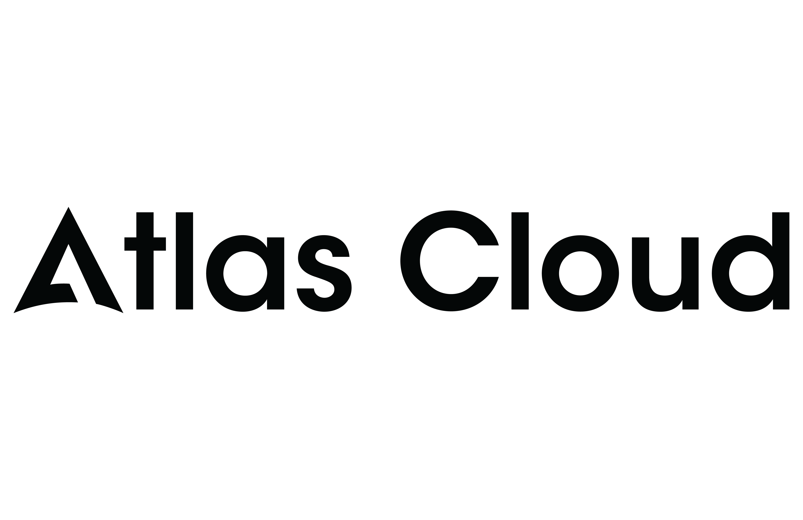

<p align="center">
  
</p>

<h1 align="center">OpenRelay</h1>

<p align="center"><b>聚合本机与直连 AI 配额，一键接入本地项目</b></p>

<p align="center">
  <a href="https://github.com/romgX/openrelay/releases/latest"></a>
  <a href="LICENSE"></a>
  
  <a href="https://openrelay.cc"></a>
  <a href="https://t.me/openrelay_updates"></a>
  <a href="https://t.me/openrelay_chat"></a>
</p>

<p align="center"><a href="#中文">中文</a> | <a href="#english">English</a></p>

---

<p align="center">
  <a href="https://www.atlascloud.ai/?utm_source=github&utm_medium=link&utm_campaign=openrelay">
    
  </a>
</p>

> 🎁 **[Atlas Cloud](https://www.atlascloud.ai/?utm_source=github&utm_medium=link&utm_campaign=openrelay)** is a supported provider in OpenRelay — add it as a direct API source with 59+ models (Claude, GPT-5, Gemini, DeepSeek, Qwen, Kimi and more) via a single OpenAI-compatible endpoint. Perfect for routing, failover groups, and multi-model quota management in OpenRelay — free API credits for open source projects — [coding plan](https://www.atlascloud.ai/console/coding-plan)

<details>
<summary>All Atlas Cloud LLM models (59)</summary>

- Anthropic: `anthropic/claude-haiku-4.5-20251001`, `anthropic/claude-opus-4.8`, `anthropic/claude-sonnet-4.6`
- OpenAI: `openai/gpt-5.4`, `openai/gpt-5.5`
- Google Gemini: `google/gemini-3.1-flash-lite`, `google/gemini-3.1-pro-preview`, `google/gemini-3.5-flash`
- Qwen: `qwen/qwen2.5-7b-instruct`, `Qwen/Qwen3-235B-A22B-Instruct-2507`, `qwen/qwen3-235b-a22b-thinking-2507`, `qwen/qwen3-30b-a3b`, `Qwen/Qwen3-30B-A3B-Instruct-2507`, `qwen/qwen3-30b-a3b-thinking-2507`, `qwen/qwen3-32b`, `qwen/qwen3-8b`, `Qwen/Qwen3-Coder`, `qwen/qwen3-coder-next`, `qwen/qwen3-max-2026-01-23`, `Qwen/Qwen3-Next-80B-A3B-Instruct`, `Qwen/Qwen3-Next-80B-A3B-Thinking`, `Qwen/Qwen3-VL-235B-A22B-Instruct`, `qwen/qwen3-vl-235b-a22b-thinking`, `qwen/qwen3-vl-30b-a3b-instruct`, `qwen/qwen3-vl-30b-a3b-thinking`, `qwen/qwen3-vl-8b-instruct`, `qwen/qwen3.5-122b-a10b`, `qwen/qwen3.5-27b`, `qwen/qwen3.5-35b-a3b`, `qwen/qwen3.5-397b-a17b`, `qwen/qwen3.6-35b-a3b`, `qwen/qwen3.6-plus`
- DeepSeek: `deepseek-ai/deepseek-ocr`, `deepseek-ai/deepseek-r1-0528`, `deepseek-ai/DeepSeek-V3-0324`, `deepseek-ai/DeepSeek-V3.1`, `deepseek-ai/DeepSeek-V3.1-Terminus`, `deepseek-ai/deepseek-v3.2`, `deepseek-ai/DeepSeek-V3.2-Exp`, `deepseek-ai/deepseek-v4-flash`, `deepseek-ai/deepseek-v4-pro`
- Kimi: `moonshotai/Kimi-K2-Instruct`, `moonshotai/Kimi-K2-Instruct-0905`, `moonshotai/Kimi-K2-Thinking`, `moonshotai/kimi-k2.5`, `moonshotai/kimi-k2.6`
- GLM: `zai-org/GLM-4.6`, `zai-org/glm-4.7`, `zai-org/glm-5`, `zai-org/glm-5-turbo`, `zai-org/glm-5.1`, `zai-org/glm-5v-turbo`
- MiniMax: `MiniMaxAI/MiniMax-M2`, `minimaxai/minimax-m2.1`, `minimaxai/minimax-m2.5`, `minimaxai/minimax-m2.7`
- xAI: `xai/grok-4.3`
- KAT: `kwaipilot/kat-coder-pro-v2`
- Other: `owl`

</details>

---

<a name="中文"></a>

## 痛点

**你的 AI 订阅，各自为政。**

Claude Pro 只能在 Claude Desktop 用。Kiro 配额只能在 Kiro 用。Groq 免费但每个工具都要手动配置。Cursor 500 次用完了，你只能停下来。

**OpenRelay 打破这道墙。**

- 帮你发现和接入更多可用 AI 模型配额（Groq、Cerebras、SambaNova、Gemini 等，按供应商账户实际可用）
- 帮你把免费或收费的配额接入你正在使用的 AI 工具
- 一键配置 Claude Code、OpenClaw、Aider、Goose 等所有工具的模型

## 演示


<table>
  <tr>
    <td><br><sub>自动发现的 Provider 和配额状态</sub></td>
    <td><br><sub>一键配置 Claude Code、OpenClaw、Aider...</sub></td>
  </tr>
  <tr>
    <td><br><sub>IDE 代理——Cursor、Windsurf、VS Code Copilot</sub></td>
    <td><br><sub>自定义模型组，自动故障转移</sub></td>
  </tr>
</table>

---

## OpenRelay 能做什么

### 1. 自动发现你所有的 AI 配额

启动 OpenRelay，它会接入你已经拥有的 AI 来源 — Claude Desktop、Claude Code、Kiro、Windsurf、Antigravity、OpenCode、VS Code Copilot、OpenAI Codex、Gemini CLI、Rovo Dev、QClaw 等。已发现的本地配额可在面板中统一管理；部分来源需要先登录原应用或配置 API Key。

支持 34 个直连 API 或本地端点（Groq、Gemini API、DeepSeek、Mistral、OpenRouter、LongCat、千帆、七牛、Anthropic API、Ollama 等）— 按供应商要求配置 API Key 或端点后可复用。

**45 个非虚拟提供商。一个面板。一个端点。**

### 2. 任意配额用在任意工具

你的 Claude Pro 订阅现在可以驱动 Claude Code、Aider、Continue、Goose、Amp，或任何支持 Anthropic/OpenAI API 的工具：

```powershell
# Windows (PowerShell)
$env:ANTHROPIC_BASE_URL="http://localhost:18765"
$env:ANTHROPIC_API_KEY="unused"
```

```bash
# macOS / Linux
export ANTHROPIC_BASE_URL=http://localhost:18765
export ANTHROPIC_API_KEY=unused
```

搞定。Claude Code 现在使用你的 Claude Desktop 配额。

想在 Aider 里用 Kiro 的免费 Claude Sonnet？改一下 URL：
```
ANTHROPIC_BASE_URL=http://localhost:18765/kiro
```

### 3. 一键配置所有 CLI 工具

不再手动编辑 `.zshrc`，不再来回倒腾环境变量。打开 Web 面板，选择 Provider，点一下开关：

- **Claude Code** → 走 Kiro（按你的 Kiro 账户额度）
- **Aider** → 走 Groq（低延迟推理）
- **Goose** → 走 Gemini API（大上下文模型）
- **OpenCode** → 走 DeepSeek（最便宜的编程模型）

重开终端，完事。每个工具都配好了。

### 4. 给你的 IDE 无缝接入外部配额

Cursor 配额烧完了？Windsurf 额度用光了？别停下编码 — 无缝插入任何其他配额来源：

| IDE | 接入方式 | 效果 |
|-----|---------|------|
| **Cursor** | RPC 代理 (ConnectRPC, HTTP/2) | 在 Cursor 里用 Claude/Kiro/Groq/任意 Provider |
| **Windsurf** | RPC 代理 (ConnectRPC) | 用任意 Provider 替换 Windsurf 内置模型 |
| **VS Code Copilot** | Ollama BYOK 桥接 | 用任意模型作为 Copilot 后端 |
| **Antigravity** | Gemini REST 代理 | 通过任意 Provider 路由 |

在面板启动代理，IDE 无感切换。

### 5. 组合配额，减少手动切换

把多个 Provider 的配额合并成一个虚拟模型：

```
"fast-group" = Groq (Llama 90B) + Cerebras (Llama 70B) + SambaNova (Llama 405B)
```

Groq 额度不可用 → 自动切到 Cerebras → 再切 SambaNova。跨 Provider 轮询和故障转移会继续使用你配置的可用额度，减少手动切换。

---

## 安装 & 快速上手

> **直接下载可执行文件运行，无需 npm install / node 环境。**

**Windows**：[点击下载 openrelay-windows-x64.exe](https://github.com/romgX/openrelay/releases/latest/download/openrelay-windows-x64.exe)，双击运行。

**macOS**（Intel / Apple Silicon 通用）：[点击下载 openrelay-macos](https://github.com/romgX/openrelay/releases/latest/download/openrelay-macos)，然后终端执行：

```bash
chmod +x openrelay-macos
xattr -d com.apple.quarantine openrelay-macos
./openrelay-macos
```

> `xattr` 命令用于解除 macOS 对未签名程序的安全限制，否则会提示"无法打开"。

**Linux**：

- x64：[点击下载 openrelay-linux-x64](https://github.com/romgX/openrelay/releases/latest/download/openrelay-linux-x64)
- ARM64 / aarch64：[点击下载 openrelay-linux-arm64](https://github.com/romgX/openrelay/releases/latest/download/openrelay-linux-arm64)

然后终端执行对应文件：

```bash
# x64
chmod +x openrelay-linux-x64
./openrelay-linux-x64

# ARM64 / aarch64
chmod +x openrelay-linux-arm64
./openrelay-linux-arm64
```

> Linux 支持的本地/CLI Provider：Claude Code、Kiro、Windsurf、OpenCode、VS Code Copilot、OpenAI Codex、Gemini CLI、Rovo Dev。Claude Desktop 和 Antigravity 目前无 Linux 版本。QClaw 取决于桌面应用和本地 gateway，可降级运行。凭证存取通过 `secret-tool`（gnome-keyring）或文件缓存。

浏览器打开 `http://localhost:18765` — 一切在 Web 面板中管理，支持中英双语。

> 觉得有用？给个 **Star** ⭐ 是对我们最大的支持！

---

## 安全

**凭据留在本机** — 应用 token/cookie 从你的机器读取，只用于连接原供应商。通过 OpenRelay 添加的 API Key 存储在本机 `~/.openrelay/` 配置中。

**直连 AI 后端** — AI 请求从你的机器直接发送到所选 Provider，OpenRelay 官方服务器不在请求链路中。

**默认不记录提示词内容** — 消息内容默认不会写入日志、缓存或持久化；只有你显式开启本地 request-shape 调试时才会输出排障信息。

**最小产品网络请求** — 许可证和更新检查可能访问 OpenRelay/GitHub 端点，但不会携带 Provider 凭据或对话内容。

**可审计** — 凭据处理代码（[cookie.ts](src/cookie.ts)）可查看审计。

详见 [DISCLAIMER.md](DISCLAIMER.md) 和 [PRIVACY.md](PRIVACY.md)。

## 常见问题

遇到问题？查看 **[常见问题 (中文)](faq.md)** | **[FAQ (English)](faq-en.md)**。

## 社区

- **官方社区论坛**：[openrelay.cc](https://openrelay.cc) — 攻略、Provider 评测、跳蚤市场、Bug 反馈
- QQ 群：**1087788461**
- Telegram 讨论群：[t.me/openrelay_chat](https://t.me/openrelay_chat)
- Telegram 更新频道：[t.me/openrelay_updates](https://t.me/openrelay_updates)
- 问题反馈：[GitHub Issues](https://github.com/romgX/openrelay/issues)

点个 **Star** ⭐ + 加入 [社区](https://openrelay.cc) 或 [Telegram 群](https://t.me/openrelay_chat)，有机会领 **1 个月 Pro 体验码**。

## 许可证

Open Core 模式：
- **框架部分**（代理、格式转换、配置）：[MIT](LICENSE)
- **Pro 功能**（模型组合、更高请求量上限）：[商业授权](COMMERCIAL-LICENSE.txt)

---

<a name="english"></a>

<p align="right"><b>中文</b> | <a href="#english">English</a></p>

## The Problem

**Your AI subscriptions are locked in silos.**

Claude Pro only works in Claude Desktop. Kiro quota only works in Kiro. Groq is free but you have to configure every tool manually. Cursor burned through your 500 requests and now you're stuck.

**OpenRelay breaks the silos.**

- Find and connect more usable AI quota (Groq, Cerebras, SambaNova, Gemini, and others, depending on your provider accounts)
- Connect any quota to any tool you're already using
- One-click configure Claude Code, OpenClaw, Aider, Goose, and more

## Demo


<table>
  <tr>
    <td><br><sub>Auto-discovered providers & quota status</sub></td>
    <td><br><sub>One-click configure Claude Code, OpenClaw, Aider...</sub></td>
  </tr>
  <tr>
    <td><br><sub>IDE proxies — Cursor, Windsurf, VS Code Copilot</sub></td>
    <td><br><sub>Custom model groups with auto-failover</sub></td>
  </tr>
</table>

---

## What OpenRelay Actually Does

### 1. Auto-discover all your AI quotas

Launch OpenRelay and it connects the AI sources already available to you — Claude Desktop, Claude Code, Kiro, Windsurf, Antigravity, OpenCode, VS Code Copilot, OpenAI Codex, Gemini CLI, Rovo Dev, QClaw, and more. Discovered local quotas are managed from one dashboard; some sources require logging in to the original app or configuring an API key first.

Plus 34 direct API or local providers (Groq, Gemini API, DeepSeek, Mistral, OpenRouter, LongCat, Qianfan, Qiniu, Anthropic API, Ollama, and more) — enter an API key or endpoint once and it can be reused across tools.

**45 non-virtual providers. One dashboard. One endpoint.**

### 2. Use any quota in any tool

Your Claude Pro subscription can now power Claude Code, Aider, Continue, Goose, Amp, or any tool that speaks Anthropic/OpenAI API:

```powershell
# Windows (PowerShell)
$env:ANTHROPIC_BASE_URL="http://localhost:18765"
$env:ANTHROPIC_API_KEY="unused"
```

```bash
# macOS / Linux
export ANTHROPIC_BASE_URL=http://localhost:18765
export ANTHROPIC_API_KEY=unused
```

That's it. Claude Code now uses your Claude Desktop quota.

Want to use Kiro's free Claude Sonnet quota in Aider? Just change the URL:
```
ANTHROPIC_BASE_URL=http://localhost:18765/kiro
```

### 3. One-click setup for every CLI tool

No more editing `.zshrc` or juggling environment variables. Open the Web dashboard, pick a provider for each tool, flip a switch:

- **Claude Code** → route through Kiro (using your Kiro account quota)
- **Aider** → route through Groq (low-latency inference)
- **Goose** → route through Gemini API (large-context models)
- **OpenCode** → route through DeepSeek (cheapest coding model)

Reopen your terminal. Done. Every tool is configured.

### 4. Supercharge your IDE with external quotas

Cursor quota burned through? Windsurf credits gone? Don't stop coding — seamlessly plug in any other quota source:

| IDE | How it works | What you get |
|-----|-------------|--------------|
| **Cursor** | RPC proxy (ConnectRPC, HTTP/2) | Use Claude/Kiro/Groq/any provider inside Cursor |
| **Windsurf** | RPC proxy (ConnectRPC) | Replace Windsurf's built-in models |
| **VS Code Copilot** | Ollama BYOK bridge | Use any model as a Copilot backend |
| **Antigravity** | Gemini REST proxy | Route through any provider |

Start the proxy from the dashboard. Your IDE doesn't know the difference.

### 5. Combine quotas with failover

Take quotas from multiple providers and merge them into a single virtual model:

```
"fast-group" = Groq (Llama 90B) + Cerebras (Llama 70B) + SambaNova (Llama 405B)
```

When Groq quota is unavailable → automatic failover to Cerebras → then SambaNova. Round-robin and failover keep using the providers you configured while quota remains, reducing manual switching.

---

## Supported Providers (45 non-virtual)

### Local / CLI / IDE Providers (11)

These use local app sessions, CLI auth files, or local gateways when available.

| Provider | Credential source | Notes |
|----------|-------------------|-------|
| **Claude Desktop** | Local Claude Desktop session | Claude Pro/Max account quota |
| **Claude Code** | Claude Code credentials | Claude account quota |
| **Kiro** (AWS) | Kiro app session | Kiro account quota |
| **Windsurf** (Codeium) | Windsurf session | IDE quota and models |
| **Antigravity** | Antigravity app session | Gemini-compatible route |
| **OpenCode** | OpenCode local config | Built-in route |
| **VS Code Copilot** | VS Code / GitHub Copilot session | Copilot account quota |
| **OpenAI Codex** | Codex local auth | REST + WebSocket transport |
| **Gemini CLI** | `~/.gemini/oauth_creds.json` | Gemini CLI OAuth |
| **Rovo Dev** | Atlassian / Rovo Dev config or env | Rovo account quota |
| **QClaw** | QClaw local gateway | Agent gateway; best for QClaw workflows |

### API / Local Providers (34)

These use your provider API key, provider account, or local endpoint. Quotas and free tiers are controlled by each upstream provider and can change.

| Provider | Type |
|----------|------|
| **Groq** | OpenAI-compatible API |
| **Cerebras** | OpenAI-compatible API |
| **OpenRouter** | OpenAI-compatible API |
| **SambaNova** | OpenAI-compatible API |
| **Gemini API** | OpenAI-compatible API |
| **Mistral** | OpenAI-compatible API |
| **xAI** | OpenAI-compatible API |
| **SiliconFlow** | OpenAI-compatible API |
| **Zhipu / GLM** | OpenAI-compatible API |
| **Together AI** | OpenAI-compatible API |
| **DashScope** | OpenAI-compatible API |
| **DeepSeek** | OpenAI-compatible API |
| **NVIDIA NIM** | OpenAI-compatible API |
| **GitHub Models** | OpenAI-compatible API |
| **Fireworks** | OpenAI-compatible API |
| **Volcengine** | OpenAI-compatible API |
| **Qianfan** | OpenAI-compatible API |
| **Qiniu** | OpenAI-compatible API |
| **Moonshot** | OpenAI-compatible API |
| **Baichuan** | OpenAI-compatible API |
| **Stepfun** | OpenAI-compatible API |
| **MiniMax** | OpenAI-compatible API |
| **Hunyuan** | OpenAI-compatible API |
| **Cloudflare AI** | OpenAI-compatible API |
| **HuggingFace** | OpenAI-compatible API |
| **LongCat** | OpenAI-compatible API |
| **Kilo** | OpenAI-compatible API |
| **LLM7** | OpenAI-compatible API |
| **Vercel AI Gateway** | OpenAI-compatible API |
| **BlazeAPI** | OpenAI-compatible API |
| **Pollinations** | OpenAI-compatible API |
| **BazaarLink** | OpenAI-compatible API |
| **Anthropic API** | Native Anthropic API |
| **Ollama** | Local endpoint |

---

## Install & Quick Start

> **Download and run — no npm install or Node.js required.**

**Windows**: [Download openrelay-windows-x64.exe](https://github.com/romgX/openrelay/releases/latest/download/openrelay-windows-x64.exe), double-click to run.

**macOS** (Intel / Apple Silicon universal): [Download openrelay-macos](https://github.com/romgX/openrelay/releases/latest/download/openrelay-macos), then run in terminal:

```bash
chmod +x openrelay-macos
xattr -d com.apple.quarantine openrelay-macos
./openrelay-macos
```

> `xattr` removes macOS Gatekeeper quarantine flag — without it, macOS will block the unsigned binary.

**Linux**:

- x64: [Download openrelay-linux-x64](https://github.com/romgX/openrelay/releases/latest/download/openrelay-linux-x64)
- ARM64 / aarch64: [Download openrelay-linux-arm64](https://github.com/romgX/openrelay/releases/latest/download/openrelay-linux-arm64)

Then run the matching file in terminal:

```bash
# x64
chmod +x openrelay-linux-x64
./openrelay-linux-x64

# ARM64 / aarch64
chmod +x openrelay-linux-arm64
./openrelay-linux-arm64
```

> Supported local / CLI providers on Linux: Claude Code, Kiro, Windsurf, OpenCode, VS Code Copilot, OpenAI Codex, Gemini CLI, and Rovo Dev. Claude Desktop and Antigravity have no Linux builds. QClaw depends on its desktop app and local gateway, with degraded behavior where unavailable. Credentials are stored via `secret-tool` (gnome-keyring) or file-based cache.

Open `http://localhost:18765` → everything is managed from the Web dashboard.

> Found it useful? Give us a **Star** ⭐ — it helps a lot!

---

## Security

**Credentials stay local.** App tokens/cookies are read from your machine and used only to authenticate with their original provider. API keys you add in OpenRelay are stored locally under `~/.openrelay/`.

**Direct provider connections.** AI requests go from your machine to the selected AI provider. OpenRelay's own servers are not in the request path.

**No prompt logging by default.** Message content is not logged, cached, or persisted unless you explicitly enable request-shape debugging for local troubleshooting.

**Minimal product network calls.** License and update checks may contact OpenRelay/GitHub endpoints, but they do not include provider credentials or conversation content.

**Auditable.** The credential handling code ([cookie.ts](src/cookie.ts)) is available for security review.

See [DISCLAIMER.md](DISCLAIMER.md) and [PRIVACY.md](PRIVACY.md) for details.

## FAQ

Having trouble? Check the **[FAQ (English)](faq-en.md)** | **[常见问题 (中文)](faq.md)** for solutions to common issues.

## Community

- **Official Community Forum**: [openrelay.cc](https://openrelay.cc) — guides, provider reviews, marketplace, bug reports
- QQ Group / QQ 群: **1087788461**
- Telegram Chat: [t.me/openrelay_chat](https://t.me/openrelay_chat)
- Telegram Updates: [t.me/openrelay_updates](https://t.me/openrelay_updates)
- Issues: [GitHub Issues](https://github.com/romgX/openrelay/issues)

**Star** ⭐ this repo + join [forum](https://openrelay.cc) or [Telegram group](https://t.me/openrelay_chat) → chance to get **1-2 months Pro free**.

## License

Open Core model:
- **Framework** (proxy, format translation, config): [MIT](LICENSE)
- **Pro features** (custom model groups, higher request limits): [Commercial](COMMERCIAL-LICENSE.txt)
